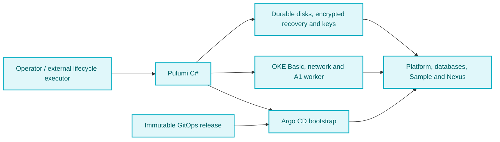

# DRN-Project Pulumi Ops

[](https://github.com/duranserkan/DRN-Project)
[](https://github.com/duranserkan/DRN-Project-Argo-CD-Gitops)

[](https://hub.docker.com/u/duranserkan)
[](https://www.nuget.org/profiles/duranserkan)

[](https://www.pulumi.com/docs/) [](https://www.pulumi.com/registry/packages/oci/) [](https://github.com/pulumiverse/awesome-pulumi)

[](https://docs.oracle.com/en-us/iaas/Content/home.htm) [](https://github.com/neitsab/awesome-oracle-cloud-free-tier)

Oracle Cloud infrastructure for [DRN-Project](https://github.com/duranserkan/DRN-Project), using Pulumi with C# and Oracle Kubernetes Engine (OKE). The planned staging cluster runs Sample, Nexus and the full platform stack through Argo CD, with data and credentials retained across recreation.

**Status: planning.** The Pulumi project, lifecycle CLI and provisioning CI are not implemented. This guide covers preparation and operating requirements; no deployment has been verified.

[Architecture](#architecture-and-ownership) | [Baseline and cost](#baseline-and-cost) | [Tools](#install-local-tools) | [OCI preparation](#prepare-oci-access) | [Pulumi](#prepare-pulumi) | [Network and storage](#prepare-networking-and-storage) | [Deployment](#deploy-and-bootstrap-staging) | [Access](#connect-to-the-cluster) | [Validation](#validate-the-deployment) | [Recovery](#operate-and-recover) | [Troubleshooting](#troubleshooting) | [Roadmap](#implementation-roadmap) | [References](#learning-resources)

## Architecture and ownership

Pulumi is infrastructure as code: C# declares resources, providers call cloud APIs, and a backend stores the state used to reconcile later changes. A Pulumi stack is an independently configured instance of a project. OKE manages the Kubernetes control plane. Its worker runs the application pods. Argo CD reconciles the Kubernetes configuration from Git.



The proposed lifecycle separates three Pulumi stacks:

| Owner | Responsibility |
|---|---|
| Durable stack | Data volume, encrypted recovery inventory and independently recoverable keys |
| Cluster stack and lifecycle executor | VCN, subnets, OKE, node pool, identities, disk attachment and host mounts |
| Bootstrap stack | Pinned Argo CD installation, restricted projects, staging root and static volume bindings |
| [Argo CD GitOps](https://github.com/duranserkan/DRN-Project-Argo-CD-Gitops) | Platform charts, operators, policies, workload manifests and first-install credential Jobs |
| [DRN-Project](https://github.com/duranserkan/DRN-Project) | Application source, builds and image publishing |

Pulumi must not also manage workload objects owned by Argo CD. Argo CD must not receive cloud teardown authority. Keep state and the external replacement executor available when the cluster is gone.

| Repository path | Contents |
|---|---|
| [README.md](README.md) | Operator entry point and implementation status |
| [Infrastructure assessment](docs/pulumi-infrastructure-assessment.md) | Detailed decisions, capacity comparisons, recovery contract and ordered backlog |

Private image distribution will be evaluated after deployment and recovery pass acceptance.

## Baseline and cost

| Setting | Proposed staging configuration |
|---|---|
| Cloud / placement | OCI home region, verified tenancy-specific availability domain |
| Account | Paid tenancy (Pay As You Go), with verified unused A1 free allowance |
| Control plane | OKE **Basic**, explicitly selected |
| Worker | One `VM.Standard.A1.Flex`, **4 OCPUs / 4 Arm cores, 24 GB RAM** |
| Storage | **128 GB retained data**, separate **64 GB disposable boot** volume |
| Applications | Full staging stack, including Graylog, MongoDB and Data Node |
| Access | Authenticated local tunnels, explicit Traefik `ClusterIP` Service |
| Releases | Existing public Docker Hub images pinned by digest, public NuGet dependencies |
| Production | Disabled |

**Target: the paid-tenancy A1 free allowance.** Oracle's price list gives paid tenancies 3,000 A1 OCPU-hours and 18,000 GB-hours per month, shared across A1 compute usage. This worker consumes 2,976 OCPU-hours and 17,856 GB-hours in a 31-day month. Verify the paid account's entitlement and unused allowance before deployment. The smaller Always Free-only allowance does not cover this configuration, and A2/A4 are not covered by the A1 allowance. [OCI price list](https://www.oracle.com/cloud/price-list/)

Its disks total 192 GB of the shared 200 GB boot/block allowance, leaving only 8 GB before other tenancy volumes. Confirm storage eligibility separately. Paid tenancy enables charges for excess usage and services outside free allowances. Account upgrade and billing consent are operator prerequisites. [Always Free resources](https://docs.oracle.com/en-us/iaas/Content/FreeTier/freetier_topic-Always_Free_Resources.htm)

OKE Basic has no cluster-management fee. Confirm account access and budget workers, storage and ancillary services separately. Do not treat trial credit as a sustainable allowance. [OKE cluster types](https://docs.oracle.com/en-us/iaas/Content/ContEng/Tasks/contengcomparingenhancedwithbasicclusters_topic.htm)

Inventory backup retention, state/recovery storage, networking, public endpoints, transfer and deployment tooling. A second 64 GB boot volume during replacement raises disk allocation to 256 GB. Plan downtime without automatic surge capacity. Budget alerts notify about spending; they do not enforce a hard cap.

Unavailable A1 capacity or failed eligibility blocks deployment. Consider paid capacity only when measurements show the full stack does not fit, then record the smallest sufficient increase and cost. Do not remove logging to make it fit. Other providers, private registries and production remain deferred. See the [cost policy and acceptance backlog](docs/pulumi-infrastructure-assessment.md).

## Install local tools

Install tools from their upstream instructions and record versions before deployment. This repository does not yet pin a tested toolchain.

| Tool | Purpose / installation |
|---|---|
| Git | Retrieve this repository and the selected GitOps release |
| .NET SDK | Build the future C# infrastructure project; follow [Pulumi .NET setup](https://www.pulumi.com/docs/iac/languages-sdks/dotnet/) |
| Pulumi CLI | Preview and apply infrastructure; [installation](https://www.pulumi.com/docs/install/) |
| OCI CLI | Login, regional discovery and kubeconfig authentication; [installation](https://docs.oracle.com/en-us/iaas/Content/API/SDKDocs/cliinstall.htm) |
| kubectl | Inspect Kubernetes; match the supported control-plane version |
| Helm and Argo CD CLI | Install and inspect the GitOps bootstrap |
| Linkerd CLI and kubeseal | GitOps platform diagnostics and sealed-secret workflows |

Use the GitOps repository's [tool and bootstrap guide](https://github.com/duranserkan/DRN-Project-Argo-CD-Gitops#bootstrap-a-cluster) for platform-specific versions. Optional context-switching tools and Headlamp are described in its [tools section](https://github.com/duranserkan/DRN-Project-Argo-CD-Gitops#tools).

Local version checks:

```sh
git --version
dotnet --info
pulumi version
oci --version
kubectl version --client
helm version
argocd version --client
```

## Prepare OCI access

### Account, region and permissions

Before resource creation, record these in access-controlled deployment configuration:

- Tenancy OCID, confirmed paid account type, home region and remaining A1 and storage free allowances.
- Region display name, identifier, region key and exact availability-domain name returned by OCI.
- Separate cluster and durable compartment OCIDs, with deletion boundaries.
- Operator identity, required IAM policies, Kubernetes authorization and approved client network ranges.
- Supported Kubernetes version, A1 shape, compatible Arm OKE image and limits.
- Budget notifications, resource inventory and owner for billing review.

An OCID is an Oracle Cloud resource identifier. These identifiers are not passwords, but actual deployment values belong in private configuration. Scope IAM to the required compartments and operations. Cloud permission and Kubernetes role-based access control are separate checks. Use [OKE prerequisites](https://docs.oracle.com/en-us/iaas/Content/ContEng/Concepts/contengprerequisites.htm) and the [credential inventory](docs/pulumi-infrastructure-assessment.md#deployment-configuration-and-credential-inventory) to complete the setup.

### Interactive authentication and discovery

Replace every `<...>` placeholder before running these authentication and discovery commands.

```sh
oci session authenticate --region '<oci-region-id>' --profile-name DRN-STAGING
oci session validate --profile DRN-STAGING --auth security_token
oci iam region-subscription list --tenancy-id '<tenancy-ocid>' --profile DRN-STAGING --auth security_token
oci iam availability-domain list --compartment-id '<tenancy-ocid>' --region '<oci-region-id>' --profile DRN-STAGING --auth security_token
oci ce node-pool-options get --node-pool-option-id all --compartment-id '<cluster-compartment-ocid>' --region '<oci-region-id>' --profile DRN-STAGING --auth security_token
```

Confirm the home-region subscription and select the exact supported image/version pair from node-pool options. For Kubernetes 1.35 and later, follow Oracle's OL8/cgroups v2 requirements. Listed shape support does not guarantee allocation capacity. [Supported images and shapes](https://docs.oracle.com/en-us/iaas/Content/ContEng/Reference/contengimagesshapes.htm)

Browser login creates local authentication material. Protect the profile, session token and private key. Sessions expire, so validate before deployment and refresh while valid or authenticate again. OCI CLI token calls need `--auth security_token`. Unattended replacement needs its own renewable identity outside the disposable cluster. [OCI session authentication](https://docs.oracle.com/en-us/iaas/Content/API/SDKDocs/clitoken.htm)

## Prepare Pulumi

Before deployment, add `Pulumi.yaml`, C# projects, pinned SDK/provider dependencies and stack configuration.

Use `Pulumi.Oci` for OCI and `Pulumi.Kubernetes` for bootstrap resources. Configure OCI authentication explicitly: `Auth = "SecurityToken"` and `ConfigFileProfile = "DRN-STAGING"` for the interactive profile above. The provider defaults to `ApiKey`; an OCI CLI browser login alone does not select the provider's authentication mode. Match the provider region to the validated home region. [OCI provider configuration](https://www.pulumi.com/registry/packages/oci/api-docs/provider/)

### State, secrets and stack configuration

Choose a backend before the first deployment. Pulumi Cloud is the proposed initial option. A supported DIY backend requires ownership of access control, locking, backups and recovery. State tracks resource identities and must outlive the cluster. Keep encryption-key recovery independent of both the worker and its data disk. [State and backends](https://www.pulumi.com/docs/iac/concepts/state-and-backends/)

Use encrypted Pulumi secret inputs for credentials. Avoid plaintext outputs, secret-bearing command arguments and decrypted state exports. Kubernetes Secret encoding is not encryption. The durable recovery store must preserve selected application credentials as well as infrastructure state. [Pulumi secrets](https://www.pulumi.com/docs/iac/concepts/secrets/)

The future stack configuration must cover the region/compartments, node shape and image, Kubernetes version, network ranges, disk identities, backend, recovery store and immutable GitOps tag/SHA. Exact project-specific configuration keys have not been implemented. Use the [configuration inventory](docs/pulumi-infrastructure-assessment.md#deployment-configuration-and-credential-inventory) as the contract.

### Preview and deployment order

Once the projects exist, reconcile **durable → cluster → bootstrap** stacks. Select each stack explicitly and review `pulumi preview` before `pulumi up`. Check replacements, deletes, disk sizes, cluster type, node count and unexpected load balancers. A preview shows intended resource changes, not proven capacity, cost or application readiness. Run only trusted Pulumi programs. [Pulumi preview](https://www.pulumi.com/docs/iac/cli/commands/pulumi_preview/)

Pass required outputs between stacks, including cluster access and durable volume identities, without printing secret values. Configure the Kubernetes provider for the intended cluster explicitly. Stop when stack state disagrees with live resource identity and reconcile deliberately before applying further changes.

## Prepare networking and storage

### Network and access boundaries

Design the virtual cloud network (VCN), API/worker subnets, pod/service ranges, routing and network security groups together. Avoid overlapping address ranges. Allow the documented control-plane, worker, DNS and pod paths. Workers also need outbound registry, package and OCI API access. Private workers need a working egress path. Public worker addresses do not justify public SSH or application access. [OKE network configuration](https://docs.oracle.com/en-us/iaas/Content/ContEng/Concepts/contengnetworkconfig.htm)

Choose an API endpoint reachable from the operator and external executor. For private endpoints, establish private connectivity or an approved bastion path. For public endpoints, restrict source networks. Install and verify a compatible NetworkPolicy enforcement provider before workloads, including Linkerd compatibility. See [OKE networking practices](https://docs.oracle.com/en-us/iaas/Content/ContEng/Tasks/contengbestpractices_topic-Networking-best-practices.htm).

The current GitOps Traefik chart needs an explicit **`ClusterIP`** override in the owning GitOps release. An internal cloud load balancer is not equivalent. Keep demo access on local tunnels. Public exposure is deferred until DNS, trusted TLS and ingress policy are designed and verified.

### Retained storage

The proposed 128 GB disk serves seven separate logical volumes/filesystems: Sample, Nexus, PostgreSQL, MongoDB data, MongoDB logs, Graylog and Data Node. The [assessment](docs/pulumi-infrastructure-assessment.md) owns the allocation table and exact recovery requirements.

- Use static `local` PersistentVolumes (PVs), `Retain` policy and an explicit `kubernetes.io/no-provisioner` StorageClass with `WaitForFirstConsumer`.
- Propagate that class to every PersistentVolumeClaim (PVC), including operator and chart-generated claims. Pre-reserve each PV for the intended namespace/claim and verify filesystem ownership.
- Attach and verify the disk, mount each filesystem and prepare bindings before releasing workloads. Delayed-binding claims require consumers to schedule before binding completes.
- Never fall back to dynamic disks or format an existing disk when recovery information is missing.

This is custom storage automation, not native CSI-managed recovery. A replacement worker needs verified fencing of the old writer, disk detachment/reattachment in the same compatible availability domain, remounting and corrected PV node affinity. An external executor must handle unexpected replacement while the workstation is offline. Until those steps are implemented and rehearsed, retained-data deployment is blocked. [Kubernetes local volumes](https://kubernetes.io/docs/concepts/storage/volumes/#local)

## Deploy and bootstrap staging

Deployment automation must:

1. **Preflight:** validate identity, account eligibility, allowances, capacity options, image architectures, tool versions and immutable GitOps tag/SHA. Include every chart default, init container and downloaded executable in Arm compatibility checks.
2. **Provision:** reconcile durable resources, then OKE Basic, one A1 worker and network/storage prerequisites. Verify the node, mounts and policy enforcement before application reconciliation.
3. **Recover first:** if data already exists, restore credentials, trust material, initialization markers and claim mappings before operators or bootstrap Jobs start. Missing recovery material must stop deployment.
4. **Bootstrap Argo CD:** fetch installation values and bootstrap manifests from the selected GitOps snapshot. Install the pinned chart, health checks, restricted default project, bootstrap project and staging root.
5. **Sync explicitly:** request a full root sync through authenticated automation. Roots do not auto-sync. Preserve hooks and propagation of the resolved commit SHA to children. Keep production disabled.
6. **Accept and checkpoint:** wait for platform and application readiness, securely checkpoint generated credentials, then record the successful recovery generation.

Follow the [GitOps bootstrap guide](https://github.com/duranserkan/DRN-Project-Argo-CD-Gitops#bootstrap-a-cluster) and [dependency order](https://github.com/duranserkan/DRN-Project-Argo-CD-Gitops/blob/master/docs/platform-operations.md#installation-dependencies). Read the versions and files at the selected release, rather than mixing branch HEAD with a release tag. Its generic default-StorageClass guidance must be adapted to the explicit local class above before using this OCI storage design.

### Planned lifecycle interface

**Proposed commands; not implemented.**

| Proposed command | Required behavior |
|---|---|
| `drn-infra up staging --cloud oci --data-size 128` | Preflight, provision or restore, bootstrap, sync and wait for readiness |
| `drn-infra pause staging` | Quiesce writes, scale workers to zero, preserve durable state and prevent automatic scale-up |
| `drn-infra resume staging` | Restore the worker, disk attachment, mounts and workload health |
| `drn-infra down staging --keep-data` | Verify recoverability, quiesce, detach and remove only disposable resources |
| `drn-infra purge staging` | Separately confirm permanent deletion of explicitly named retained resources |

## Connect to the cluster

After a cluster exists, use OCI Console **Access cluster → Local Access** to obtain its kubeconfig command. Use the actual cluster OCID, region and endpoint. Save to a dedicated protected file rather than mixing environments. A private endpoint also requires a working network path. [OKE cluster access](https://docs.oracle.com/en-us/iaas/Content/ContEng/Tasks/contengdownloadkubeconfigfile.htm)

For the session profile above, keep these settings in the operator terminal so the kubeconfig's OCI token command uses the same identity:

```sh
export OCI_CLI_PROFILE=DRN-STAGING
export OCI_CLI_AUTH=security_token
export KUBECONFIG='<absolute-path-to-staging-kubeconfig>'
kubectl config current-context
kubectl get nodes -o wide
kubectl get storageclass
```

Check that the context is staging before every operation. Keep the OCI CLI on `PATH` and renew the session when required. Do not share kubeconfig or credentials with other users.

Once Argo CD and logging are healthy, run each tunnel in a separate terminal:

```sh
kubectl -n argocd port-forward --address localhost svc/argocd-server 8080:443
kubectl -n graylog port-forward --address localhost svc/drn-graylog 9000:9000
```

Use [Argo CD](https://localhost:8080) and [Graylog](http://localhost:9000) with their current application credentials. Tunnels provide network access, not application authentication. See the [GitOps local access guide](https://github.com/duranserkan/DRN-Project-Argo-CD-Gitops/blob/master/docs/local-access.md) for certificate handling, Linkerd Viz, Grafana and database clients. Keep database hostname verification enabled.

## Validate the deployment

Use these read-only diagnostics after provisioning and GitOps sync:

```sh
kubectl get nodes -o wide
kubectl get pods -A
kubectl get applications -n argocd
kubectl get pv
kubectl get pvc -A
kubectl get services -A
kubectl get events -A --sort-by=.metadata.creationTimestamp
```

Deployment acceptance requires:

| Check | Evidence required |
|---|---|
| Release | Root and children select the intended immutable revision and approved image digests |
| Scheduling | Native Arm execution, adequate allocatable CPU/memory, pod slots and ephemeral storage |
| Full stack | Sample/Nexus requests, database TLS, logging ingestion/search and monitoring succeed |
| Isolation | Denied cross-namespace traffic, permitted application paths and no unintended public load balancer |
| Capacity | Cold starts, steady-state load and maintenance peaks show no OOM, eviction or disk pressure |
| Host requirements | Graylog/Data Node prerequisites, including `vm.max_map_count >= 262144`, are configured |
| Repeatability | Repeat `up` preserves credentials; pause/resume restores health |
| Recovery | Worker replacement and down/recreate preserve identifiable test data and credential identity |
| Backup | Independent backup restoration works without relying on the original disk |
| Billing | Resource inventory matches the planned allowance/cost envelope, with no orphan disks or endpoints |

Use the GitOps [readiness checks](https://github.com/duranserkan/DRN-Project-Argo-CD-Gitops/blob/master/docs/platform-operations.md#readiness-checks). Record workload size, observation duration, actual node capacity and Kubernetes allocatable resources. The proposed four A1 cores and 24 GB RAM have not passed these checks.

## Operate and recover

**Retention is not backup.** Keep encrypted backups and a recovery inventory outside the worker and data disk. Include exact Secret/key mappings, database credentials, application seeds, shared trust material, initialization markers, disk/LVM/filesystem identities, PV/PVC mappings, GitOps revision and database versions. Test recovery of the encryption authority too.

Before acceptance, agree on maximum tolerable data loss (RPO), recovery time (RTO), backup frequency and retention. Budget temporary restore resources and verify that backup failures are reported while the environment is active.

The existing bootstrap Jobs cannot safely interpret missing cluster Secrets as a fresh installation when retained data exists. Use an authoritative external initialization record and checkpoint first-install progress. Restore existing identities before reconciliation. See [staging initialization](https://github.com/duranserkan/DRN-Project-Argo-CD-Gitops/blob/master/docs/staging-configuration.md#initialization-marker) and the [recovery design](docs/pulumi-infrastructure-assessment.md).

Before retained-data teardown:

1. Acquire the lifecycle lock and verify backups, credential checkpoints and decryption access.
2. Suspend relevant child reconciliation and operators, stop writes and complete supported database shutdown or backup procedures.
3. Detach retained storage and allow cluster controllers to clean up disposable cloud resources.
4. Remove bootstrap and cluster resources with explicit namespace, finalizer and PVC retention handling. Leave the durable stack managed.
5. Verify the remaining cloud inventory and bill. Recreate in the compatible availability domain, restoring recovery material before workloads.

Use Pulumi protection for durable resources as well as Kubernetes `Retain` and backups. Do not use a blanket `pulumi destroy` as the retained-data procedure. `retainOnDelete` removes Pulumi's management of the resource and needs an adoption plan. [Pulumi deletion protection](https://www.pulumi.com/docs/iac/operations/stack-management/protecting-against-undesired-changes/)

Schedule security updates, certificate/credential renewal and maintenance from the start. Test control-plane/node upgrades and planned or unexpected worker replacement. One worker means downtime. Validate scale-to-zero and boot-volume cleanup before relying on pause/resume for cost savings. Oracle may reclaim idle Always Free compute, so recovery must not depend on permanent worker availability. [Idle resource rules](https://docs.oracle.com/en-us/iaas/Content/FreeTier/freetier_topic-Always_Free_Resources.htm)

## Troubleshooting

| Symptom | Check first / safe next step |
|---|---|
| `pulumi up` has no project | Implementation is missing. Complete the implementation roadmap first. |
| OCI unauthorized or expired token | Validate the chosen profile, session, region and IAM. Check Pulumi uses `SecurityToken`, not its default `ApiKey`. |
| kubectl unauthorized / forbidden | Check kubeconfig token profile/auth and session expiry, then cloud permissions and Kubernetes RBAC separately. |
| API timeout | Check endpoint selection, private connectivity, approved client CIDRs, routes and security rules. |
| A1 out of capacity / quota exceeded | Inspect regional node-pool options and remaining limits. Stop; do not substitute a paid shape or region. |
| Pods Pending | Inspect scheduling events, allocatable capacity, taints, PVC class/claim mapping, mounts and PV node affinity. |
| `ImagePullBackOff` / exec format error | Check digest availability, Arm manifests, registry limits and outbound DNS/HTTPS. Do not remove digest pins. |
| Graylog/Data Node crash or OOM | Check memory, kernel requirements, filesystem ownership, disk space and database TLS/authentication. |
| Root sync does not progress | Confirm full explicit sync, selected revision, hooks and child dependency health. Do not bypass initialization guards. |
| Recovery asks to create new credentials | Stop. Restore the external initialization record, Secrets and markers before starting credential Jobs. |
| Unexpected bill | Inspect enhanced cluster features, load balancers, surplus boot/data disks, backups, egress and overlapping replacement workers. |

Use pod descriptions and targeted logs to diagnose failures, but redact credentials and account details before sharing output. Avoid deleting PVCs, regenerating credentials or disabling TLS as troubleshooting shortcuts.

## Implementation roadmap

- [x] Define OCI baseline, ownership and recovery requirements.
- [x] Document preparation, operating checks and deployment gates.
- [ ] Complete authorized tenancy, IAM, region, allowance and capacity preflight.
- [ ] Implement pinned C# Pulumi projects, three stacks and state/secret configuration.
- [ ] Implement storage initialization, external replacement executor and resumable lifecycle CLI.
- [ ] Prepare the GitOps release with explicit local storage classes and ClusterIP ingress.
- [ ] Verify Arm support, policy enforcement and full-stack capacity.
- [ ] Pass repeat deployment, pause/resume, upgrade, worker replacement, retained-data recreation and independent backup restore.

See the [ordered implementation backlog](docs/pulumi-infrastructure-assessment.md#ordered-implementation-backlog-and-acceptance). Private feeds/registries, additional providers and production deployment remain deferred.

## Learning resources

Resources reviewed on **18 October 2026**. Check examples against provider documentation and the selected release.

| Resource | How to use it here |
|---|---|
| [Awesome Oracle Cloud Free Tier](https://github.com/neitsab/awesome-oracle-cloud-free-tier) | Discover account setup, budget, networking and Kubernetes material. Recheck older examples against current allowance and OKE access rules. |
| [Awesome Pulumi](https://github.com/pulumiverse/awesome-pulumi) | Discover official learning paths, state/secrets guidance, providers and automation examples. Adapt concepts to C# and OCI rather than copying another cloud's design. |
| [Pulumi OCI registry](https://www.pulumi.com/registry/packages/oci/) | Inspect current C# resource APIs and authentication configuration. Pin a tested provider version when implementing. |
| [OKE documentation](https://docs.oracle.com/en-us/iaas/Content/ContEng/home.htm) | Verify prerequisites, networking, supported nodes, access and maintenance procedures. |
| [GitOps deployment README](https://github.com/duranserkan/DRN-Project-Argo-CD-Gitops#bootstrap-a-cluster) | Use the source-owned workload bootstrap after this guide's OCI prerequisites are satisfied. |

Examples have not been executed against an account or cluster. See [LICENSE](LICENSE).
