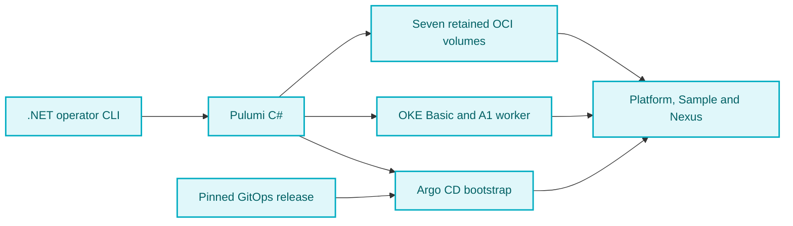

# DRN-Project Pulumi Ops

[](https://github.com/duranserkan/DRN-Project)
[](https://github.com/duranserkan/DRN-Project-Argo-CD-Gitops)

[](https://hub.docker.com/u/duranserkan)
[](https://www.nuget.org/profiles/duranserkan)

[](https://www.pulumi.com/docs/)
[](https://www.pulumi.com/registry/packages/oci/)
[](https://github.com/pulumiverse/awesome-pulumi)

[](https://docs.oracle.com/en-us/iaas/Content/home.htm)
[](https://github.com/neitsab/awesome-oracle-cloud-free-tier)

Oracle Cloud infrastructure for [DRN-Project](https://github.com/duranserkan/DRN-Project), using Pulumi with C# and Oracle Kubernetes Engine (OKE). The staging infrastructure prepares Sample, Nexus and the full platform stack for [Argo CD GitOps](https://github.com/duranserkan/DRN-Project-Argo-CD-Gitops).

[Quick start](#quick-start) | [Architecture](#architecture-and-ownership) | [Configuration](#baseline-and-cost) | [Management](#manage-staging) | [Guides](#documentation) | [Roadmap](#implementation-roadmap)

## Architecture and ownership

Pulumi provisions cloud resources and bootstraps Argo CD. Argo CD reconciles platform and application configuration from an immutable GitOps release.

Infrastructure changes run through explicit operator commands. Pushing this repository runs CI; it does not apply cloud changes. The protected operations workflow provides manual operations plus scheduled backups and checks. Promote a GitOps release through `pause`, `release` and `resume` so recovery state and retained data stay coordinated.



| Owner | Responsibility |
|---|---|
| Recovery stack | Private versioned bucket for encrypted credentials, lifecycle state and the shared operation lock |
| Durable stack | Protected OCI Block Volumes, generation-specific groups and a daily snapshot fallback |
| Cluster stack | Network, OKE Basic and the configured worker pool |
| Bootstrap stack | Pinned Argo CD installation, restricted projects, staging root and static PV bindings |
| Argo CD GitOps repository | Charts, operators, policies, workloads and credential Jobs |
| DRN-Project repository | Application source, builds and image publishing |

Pulumi state and encrypted recovery checkpoints live outside the cluster. Argo CD receives no cloud teardown authority. The operator restores stable identities before reconciliation and checks shared lock ownership before each external action. Keep the recovery key independently recoverable. See the [architecture and recovery assessment](docs/pulumi-infrastructure-assessment.md).

## Baseline and cost

| Setting | Default staging configuration |
|---|---|
| Placement | OCI home region and verified availability domain |
| Account | Pay As You Go with verified unused free allowances |
| Cluster | OKE Basic, one `VM.Standard.A1.Flex` worker |
| Networking | Private native-VCN worker/pod subnets, Calico policy enforcement, restricted public API |
| Compute | 4 OCPUs / 4 Arm cores, 24 GB RAM |
| Storage | Seven 50 GB retained CSI volumes and 64 GB disposable boot, **414 GB total** |
| Workloads | Sample, Nexus and the full platform stack, including Graylog, MongoDB and Data Node |
| Access | Authenticated tunnels and Traefik `ClusterIP` |
| Distribution | Public Docker Hub images pinned by digest and public NuGet dependencies |
| Production | Disabled |

Compute targets the paid-tenancy A1 allowance. Native CSI storage exceeds the 200 GB boot/block allowance and requires `allowBillableStorage: true` after cost review. The earlier shared 128 GB LVM design is deferred because it requires custom host recovery. Eligibility, existing usage, ancillary services and replacement resources still need review. Read the [cost breakdown and constraints](docs/baseline-and-cost.md).

## Set up staging

### Prerequisites

- Linux or macOS, Git, the .NET SDK selected by [global.json](global.json), [Pulumi CLI](https://www.pulumi.com/docs/install/), OCI CLI **3.95.0** and a compatible kubectl.
- A Pulumi Cloud account or organization with permission to create and update stacks.
- Prepared OCI compartments, IAM, API access ranges and a compatible OKE image. Review [account setup and costs](docs/setup.md) before accepting billable storage.
- A reviewed GitOps release containing `oci-retained` storage and staged activation. Record its tag and full commit SHA using the [release prerequisites](docs/todos/release-prerequisites.md).

### Quick start

For a new deployment, clone this repository and run all commands from its root. Existing deployments must use their original configuration, recovery key and state.

```sh
git clone https://github.com/duranserkan/DRN-Project-Pulumi-Ops.git
cd DRN-Project-Pulumi-Ops
pulumi login https://api.pulumi.com
pulumi whoami --verbose
oci session authenticate --region '<oci-region-id>' --profile-name DRN-STAGING
oci session validate --profile DRN-STAGING --auth security_token
mkdir -p .local
chmod 700 .local
cp -n configuration/staging.example.json .local/staging.json
chmod 600 .local/staging.json
```

Replace `<oci-region-id>` before authenticating. Follow [Pulumi installation and login](docs/setup.md#prepare-pulumi) if the CLI or account is new. This repository already contains its Pulumi project; `setup` creates/selects the four stacks, so no `pulumi new` or manual stack initialization is needed.

Replace every placeholder in `.local/staging.json` using the [configuration reference](docs/setup.md#state-secrets-and-stack-configuration). `organization` is your Pulumi username or organization slug. Set an absolute recovery-key path in an existing private directory. Set `allowBillableStorage: true` only after reviewing capacity and backup costs, starting from the 414 GB default. Keep `recoveryKeyBackedUp: false` until the key has an independent secure copy.

Validate configuration and create the key:

```sh
dotnet run --project src/Drn.Infrastructure.Operator -- validate .local/staging.json
dotnet run --project src/Drn.Infrastructure.Operator -- keygen .local/staging.json
```

Copy the generated key to independent secure storage and set `recoveryKeyBackedUp: true`. Provision the recovery bucket, initialize credentials, review the preview and deploy:

```sh
dotnet run --project src/Drn.Infrastructure.Operator -- setup .local/staging.json
dotnet run --project src/Drn.Infrastructure.Operator -- initialize .local/staging.json
dotnet run --project src/Drn.Infrastructure.Operator -- preview .local/staging.json
dotnet run --project src/Drn.Infrastructure.Operator -- up .local/staging.json
dotnet run --project src/Drn.Infrastructure.Operator -- status .local/staging.json
dotnet run --project src/Drn.Infrastructure.Operator -- check .local/staging.json
```

`dotnet run` builds the operator as needed. `validate` checks configuration without contacting OCI. `setup` is the first cloud resource mutation. `initialize` saves and reads back one encrypted credential generation before any consumer starts. `preview` covers durable storage and cluster resources; bootstrap is applied by `up` once the cluster exists.

`up` provisions infrastructure, verifies policy enforcement and activates GitOps in stages. It then takes a complete baseline backup and resumes. Keep Pulumi's approval prompts while establishing the environment. The first startup and complete backups include downtime. A successful run ends in `running` with a complete checkpoint. Use [deployment diagnostics](docs/operations.md#validate-the-deployment) to verify Argo CD and application behavior, then record the [acceptance checks](docs/todos/deployment-acceptance.md).

For optional per-stack initial provisioning, use the [staged deployment guide](docs/deployment.md#provision-infrastructure). `bootstrap` alone leaves workload sync disabled. If a command fails, inspect `status` and follow [interruption recovery](docs/operations.md#interrupted-operations) before retrying.

## Manage staging

```sh
dotnet run --project src/Drn.Infrastructure.Operator -- status .local/staging.json
dotnet run --project src/Drn.Infrastructure.Operator -- kubeconfig .local/staging.json
export OCI_CLI_PROFILE=DRN-STAGING OCI_CLI_AUTH=security_token
export KUBECONFIG="$PWD/.local/staging.kubeconfig"
kubectl get nodes -o wide
```

Use the authentication mode and profile configured in your JSON. Choose the lifecycle operation you need:

```sh
dotnet run --project src/Drn.Infrastructure.Operator -- check .local/staging.json
dotnet run --project src/Drn.Infrastructure.Operator -- backup .local/staging.json
dotnet run --project src/Drn.Infrastructure.Operator -- pause .local/staging.json
dotnet run --project src/Drn.Infrastructure.Operator -- resume .local/staging.json
dotnet run --project src/Drn.Infrastructure.Operator -- down .local/staging.json --confirm staging
```

`backup` stops writers, exports PostgreSQL/MongoDB, snapshots OpenSearch, shuts down data services and backs up all seven detached disks before resuming. `pause` leaves workers stopped; `down` also removes disposable infrastructure. Both retain protected data and recovery state, which can still incur charges. `resume` restores the recorded generation. Running environments use `check` or `backup`; `up` and `resume` do not change a running deployment. `bootstrap` is now an initial installation command, not an alias for startup or recovery.

To deploy another reviewed release, pause with the current configuration, update only `gitOpsTag` and `gitOpsCommit`, then select and resume it:

```sh
dotnet run --project src/Drn.Infrastructure.Operator -- release .local/staging.json --confirm staging
dotnet run --project src/Drn.Infrastructure.Operator -- resume .local/staging.json
```

Release selection preserves credentials and historical backups. The target must support the retained database data. Resume takes a baseline checkpoint when the selected release has none on the active storage generation. See [release changes and failed startup recovery](docs/operations.md#change-the-gitops-release).

Use a checkpoint ID from `status` for an independent restore. Select its original GitOps release first if it differs from the current release:

```sh
dotnet run --project src/Drn.Infrastructure.Operator -- restore .local/staging.json \
  --backup '<checkpoint-id>' --confirm staging --allow-additional-storage
```

Pause or down first. Restore adds a full copy of the source generation's configured disks, **350 GB with defaults**, preserves source volumes and verifies native database restoration before application writers start. Failed operations retain their shared lock; follow [interruption recovery](docs/operations.md#interrupted-operations) before unlocking. There is no purge command.

## Continuous integration

Pull requests and pushes to `develop` or `master` run .NET builds, both unit-test suites with coverage, NuGet dependency auditing, Trivy and CodeQL for C# and GitHub Actions. C# analysis builds the solution under CodeQL. Pull requests also review dependency changes for high or critical vulnerabilities. The default branch receives weekly checks.

Each `.csproj` sets `TreatWarningsAsErrors=true`. Any exception must name its diagnostic ID and explain why it is needed.

Pushes to `develop` and `master`, plus scheduled checks on those branches, run SonarCloud analysis with both coverage reports and wait for its quality gate. The scanner version is pinned in [.config/dotnet-tools.json](.config/dotnet-tools.json). [Shared CI](.github/workflows/ci.yml) owns the public project identity. Configure the repository secret before enabling branch CI:

| Setting | Location | Value |
|---|---|---|
| `SONAR_TOKEN` | Actions repository secret | Token authorized to analyze this repository's SonarCloud project |
| `SONAR_PROJECT_KEY` | Shared CI job environment | `duranserkan_DRN-Project-Pulumi-Ops` |
| `SONAR_ORGANIZATION` | Shared CI job environment | `duranserkan` |

Import this repository into SonarCloud with the identity above, select CI-based analysis and configure `master` and `develop` branch analysis with a plan that supports it. No Sonar project or organization repository variables are required. A missing token, failed analysis or failed quality gate fails branch CI. Pull-request callers pass no repository secrets and do not run SonarScanner. CI needs no OCI credentials and performs no deployment.

The [shared gatekeeper](.github/workflows/ci.yml) requires .NET validation, Trivy and CodeQL success, plus dependency review on pull requests. Sonar failures propagate through the .NET job. Configure `ci / gatekeeper` as a required check after confirming the first run. Enable the dependency graph and dependency review for this repository. Require CodeQL results through GitHub code-scanning rules for alert-based merge protection, since successful analysis/upload alone does not reject alerts. Protect `develop` and `master`, including code-owner review for workflow changes.

[CodeRabbit configuration](.coderabbit.yaml) enables assertive automatic reviews for PRs targeting any branch. It applies repository guidelines and focused checks for Pulumi resources, lifecycle recovery, tests, configuration and CI. Generated build and test output is excluded, and learned guidance stays local to this repository. Enable the CodeRabbit GitHub app for this repository to use these reviews.

Open [Drn.Pulumi.slnx](Drn.Pulumi.slnx) for the source and tests. `Drn.Infrastructure.Operator` owns the lifecycle CLI. `Drn.Pulumi` owns resource declarations. To build and run both unit-test suites locally:

```sh
dotnet build Drn.Pulumi.slnx --configuration Release
dotnet run --project tests/Drn.Pulumi.UnitTests --no-build --configuration Release
dotnet run --project tests/Drn.Infrastructure.Operator.UnitTests --no-build --configuration Release
```

See the [verification record](docs/todos/deployment-acceptance.md#local-verification) for recorded results and remaining checks.

The separate [operations workflow](.github/workflows/operations.yml) schedules backups and health checks on a protected runner outside the cluster. Configure its identity, private configuration and GitHub environment using the [operations guide](docs/operations.md#scheduled-operations); it is not active until those prerequisites exist.

## Documentation

Start with preflight and account separation, then follow setup and deployment. The checklists distinguish source implementation from runtime acceptance.

| Guide | Use it for |
|---|---|
| [Local setup and OCI preparation](docs/setup.md) | Tools, session authentication, Pulumi state, networking and storage prerequisites |
| [Deployment and bootstrap](docs/deployment.md) | Reconciliation order, GitOps bootstrap and command contracts |
| [Operations and recovery](docs/operations.md) | Cluster access, diagnostics, validation, teardown, maintenance and troubleshooting |
| [Baseline and cost](docs/baseline-and-cost.md) | Allowance arithmetic, billing boundaries and capacity policy |
| [Infrastructure assessment](docs/pulumi-infrastructure-assessment.md) | Architecture decisions, historical alternatives, recovery contracts and ordered acceptance gates |
| [Learning resources](docs/references.md) | Official documentation and upstream project references |

## Implementation roadmap

Checked items describe implemented source, not an executed deployment or verified recovery.

- [x] .NET recovery, durable, cluster and bootstrap stacks with protected storage and explicit configuration
- [x] Setup, staged activation, access, pause/resume, teardown and independent restore commands
- [x] Unit-test projects and shared CI with coverage and security scans
- [x] OCI storage-class and ClusterIP integration in the GitOps source
- [x] Encrypted credential checkpoints, cross-host coordination and resumable lifecycle records
- [x] Native database backups, offline OCI group checkpoints, retention and a scheduled fallback
- [x] Native pod networking, Calico enforcement and live allow/deny readiness checks
- [x] Protected external-runner workflow for backups, checks and routine operations
- [x] Configurable worker count, standard Flex shape, CPU/RAM, boot size and per-claim data size/tier with one AD and automatic FD placement
- [ ] Confirm [cost and recovery objectives](docs/todos/cost-recovery-objectives.md), [OCI preflight](docs/todos/oci-preflight.md) and [account separation](docs/todos/account-separation.md)
- [ ] Publish and verify the integrated [release prerequisites](docs/todos/release-prerequisites.md)
- [ ] Exercise [credential recovery](docs/todos/credential-recovery.md) and interrupted shared operations
- [ ] Verify [CSI storage recovery](docs/todos/storage-recovery.md) and [GitOps activation](docs/todos/gitops-integration.md)
- [ ] Verify [backups and independent restore](docs/todos/backup-restore.md) with identifiable data and measured costs
- [ ] Complete [full-stack and lifecycle acceptance](docs/todos/deployment-acceptance.md)

Follow the [ordered implementation backlog](docs/pulumi-infrastructure-assessment.md#ordered-implementation-backlog-and-acceptance) for dependencies and acceptance criteria. Detailed implementation progress lives in [Pulumi stacks and lifecycle CLI](docs/todos/pulumi-lifecycle.md).

Configure workers and retained block volumes through the [configuration reference](docs/setup.md#configure-workers-and-storage). Existing defaults remain unchanged. Other providers, multiple ADs, alternative storage backends, private distribution and public DNS/TLS remain deferred.

[Docker Hub](https://hub.docker.com/u/duranserkan) · [NuGet](https://www.nuget.org/profiles/duranserkan) · [License](LICENSE)
